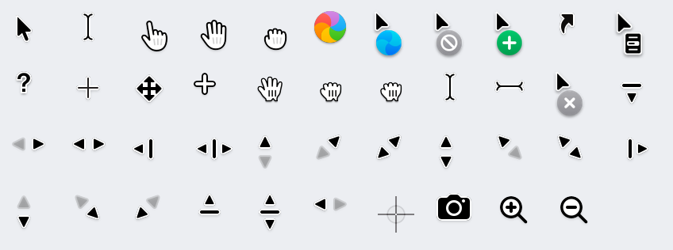

# macOS 27 Golden Gate Cursors

The complete system cursor set of **macOS 27 Golden Gate** (27.0.1, build 26A434), extracted from Apple's public restore image and packaged for **older macOS**, **Windows** and **Linux**.

Golden Gate brings back the classic glove-style hand cursors that macOS 26 Tahoe removed. This repository lets you use them, together with the rest of the macOS 27 pointers, on machines that cannot run macOS 27.



## Download

Grab the archive for your platform from the [latest release](../../releases/latest), or use the folders under [`themes/`](themes) directly.

| Platform | Package | Install |
|---|---|---|
| macOS (older versions) | `themes/macos/macOS27-GoldenGate.cape` | Open it with [Mousecape](https://github.com/alexzielenski/Mousecape), select it and press **Apply** |
| Windows 10 / 11 | `themes/windows/macOS27-GoldenGate/` | Double-click `install.bat` and confirm the prompt (copies, registers, activates and reloads in one go) |
| macOS Sonoma / Sequoia (if some cursors stay default) | `themes/macos/macOS27-GoldenGate-Compat.cape` | Same as above; this cape keeps every animation within Mousecape's 24-frame limit, see [docs/INSTALL.md](docs/INSTALL.md) |
| Windows 10 / 11, larger (1.1x) | `themes/windows/macOS27-GoldenGate-Large/` | Same as above (`install.bat`); installs as a separate scheme next to the normal one |
| Linux (X11 / Wayland) | `themes/linux/macOS27-GoldenGate/` | Run `sh install.sh`, or copy the folder to `~/.icons/` and select it in your cursor settings |

Detailed steps for each platform are in [docs/INSTALL.md](docs/INSTALL.md).

## What is included

- **43 cursors**: arrow, I-beam (horizontal and vertical text), animated spinning wait cursor, animated "busy but clickable", the three new Golden Gate glove hands (pointing, open, closed), counting hands, all window/edge resize cursors, move, copy, alias, contextual menu, not-allowed, poof, help, crosshair, cell, zoom in/out and the two screenshot cursors.
- **High resolution**: macOS cape at 1x/2x/5x/10x; Windows cursors at 32–128 px; Linux Xcursor at 24–96 px.
- **Original sources** in [`source/`](source): Apple's vector PDFs with their `info.plist` metadata, the bitmap cursors decoded from SkyLight, and the Accessibility colour-layer templates.

The full cursor-by-cursor mapping for each platform is in [docs/MAPPING.md](docs/MAPPING.md).

## Where the cursors come from

macOS keeps its cursors in three places. All of them were copied unmodified from the root filesystem of `UniversalMac_27.0.1_26A434_Restore.ipsw`:

| Location in macOS 27 | Contents |
|---|---|
| `HIServices.framework/…/Resources/cursors/` | 40 vector cursors (`cursor.pdf` + `info.plist`). The `macos27/` subfolder holds the new glove hands. |
| `SkyLight.framework/…/Resources/CursorAsset` | Arrow, I-beam and spinning wait cursor as raw bitmaps inside a Mach-O binary. |
| `AccessibilityFoundation.framework/…/Resources/Cursors*` | Fill/outline layers used when a custom pointer colour is set in Accessibility. |

There are **no separate light-mode and dark-mode cursor files**: macOS draws the same black-and-white pointers in both appearances. See [docs/SOURCES.md](docs/SOURCES.md) for file formats and details.

## Reproduce it yourself

Everything here can be regenerated from Apple's public download with the scripts in [`tools/`](tools):

```sh
pip install -r tools/requirements.txt
tools/extract.sh          # download, decrypt and mount the IPSW, copy the cursor sources into source/
python3 tools/build.py    # build themes/ for macOS, Windows and Linux
```

The whole process, including the required third-party tools, is documented in [docs/EXTRACTION.md](docs/EXTRACTION.md).

## Repository layout

```
source/          Original files extracted from macOS 27 (Apple's artwork, unmodified)
  hiservices/      vector cursors from HIServices.framework
  skylight/        bitmaps decoded from SkyLight CursorAsset (+ info.json)
  accessibility/   colour-layer templates from AccessibilityFoundation
themes/          Ready-to-install themes generated by tools/build.py
  macos/           Mousecape cape
  windows/         .cur / .ani files and install.inf
  linux/           Xcursor theme
tools/           Extraction and build scripts
docs/            Documentation
```

## Legal

The cursor artwork is © Apple Inc. and is **not** covered by this repository's license. This project is not affiliated with or endorsed by Apple. The scripts and documentation are released under the MIT License. Please read [LEGAL.md](LEGAL.md) before using or redistributing the cursors.
